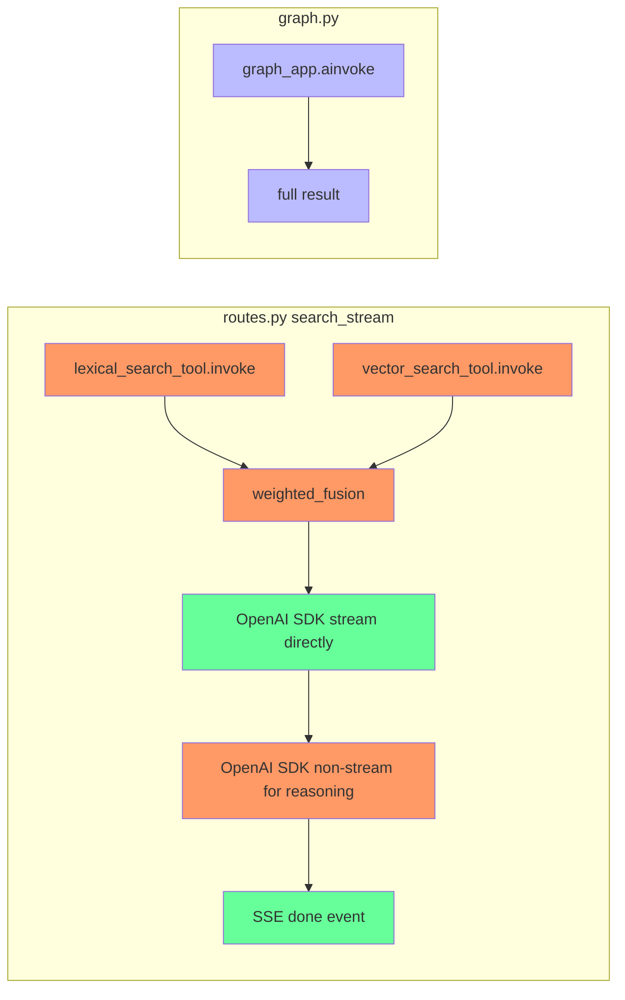

# Refactoring Plan: `stream_mode=["messages", "updates"]`

## Goal

Replace the current dual-implementation pattern (graph.py + manual search/fusion/streaming in routes.py) with a single `graph_app.astream(stream_mode=["messages", "updates"])` call that both streams tokens to the client and captures the final graph state for the `done` event.

## Current Architecture (problem)



**Problem:** The search/fusion logic is duplicated. `routes.py` manually calls tools and fusion, bypassing the graph. The graph is only used by the non-streaming `/api/search` endpoint.

## Target Architecture

```mermaid
flowchart TB
    subgraph "graph.py (single source of truth)"
        A[normalize] --> B[vector_search]
        B --> C[extract_keywords_v]
        C --> D[lexical_search_p1]
        D --> E[extract_keywords_l]
        E --> F[lexical_search_p2]
        F --> G[fuse]
        G --> H[answer - STREAMING]
        H --> I[reasoning - STREAMING]
        I --> END
    end

    subgraph "routes.py search_stream"
        J[graph_app.astream<br/>stream_mode=[messages, updates]]
        J --> K{event_type?}
        K -- "messages" --> L[SSE token / reasoning_token]
        K -- "updates" --> M[extract final state]
        M --> N[SSE done event]
    end

    graph_app.astream -.-> J
```

## Changes Required

### File 1: `backend/app/graph.py`

#### 1.1 `generate_answer` node (line 156-171)

**Current:** Uses `await _llm.ainvoke(...)` — non-streaming, returns full content at once.

**Target:** Use `_llm.astream(...)` so LangGraph can intercept individual tokens via `stream_mode="messages"`.

Key details:
- Must accumulate `full_content` from chunks to populate `state["answer"]`
- Must keep `streaming=True` on ChatOpenAI
- Must keep `.bind_tools(_llm_tools)` for tool-calling support
- The `astream` will yield `AIMessageChunk` objects — LangGraph's `stream_mode="messages"` will pick them up

```python
async def generate_answer(state: GraphState) -> GraphState:
    if not state["fused"]:
        return {"answer": None}

    model_name = state.get("model") or settings.chat_model
    _llm = ChatOpenAI(
        base_url=settings.openai_api_base_url,
        api_key=settings.openai_api_key,
        model=model_name,
        timeout=300.0,
        streaming=True,
    ).bind_tools(_llm_tools)

    prompt = build_prompt(state["query"], state["fused"], include_reasoning=False)
    
    full_content = ""
    async for chunk in _llm.astream([{"role": "user", "content": prompt}]):
        if isinstance(chunk, AIMessageChunk) and isinstance(chunk.content, str):
            full_content += chunk.content
    
    return {"answer": full_content}
```

**Important:** The `astream` here is the LLM's astream (from langchain-openai), NOT the graph's astream. LangGraph will automatically detect the streaming sub-calls and expose them via `stream_mode="messages"`.

#### 1.2 `generate_reasoning` node (line 174-204)

**Current:** Uses `await _llm.ainvoke(...)` — non-streaming.

**Target:** Use `_llm.astream(...)` for consistency. Even though reasoning is typically short, streaming it allows the client to see reasoning tokens incrementally.

```python
async def generate_reasoning(state: GraphState) -> GraphState:
    if not state["fused"] or not state.get("answer"):
        return {"reasoning_summary": [], "source_notes": [], "limitations": []}

    model_name = state.get("model") or settings.chat_model
    _llm = ChatOpenAI(
        base_url=settings.openai_api_base_url,
        api_key=settings.openai_api_key,
        model=model_name,
        timeout=300.0,
        streaming=True,
    )
    prompt = build_prompt(state["query"], state["fused"], include_reasoning=True)
    messages = [{"role": "user", "content": state["answer"]}, {"role": "user", "content": prompt}]

    full_content = ""
    try:
        async for chunk in _llm.astream(messages):
            if isinstance(chunk, AIMessageChunk) and isinstance(chunk.content, str):
                full_content += chunk.content
        
        # Parse JSON from accumulated content
        start = full_content.find("{")
        end = full_content.rfind("}")
        if start != -1 and end != -1:
            parsed = json.loads(full_content[start : end + 1])
            return {
                "reasoning_summary": parsed.get("reasoning_summary", []),
                "source_notes": parsed.get("source_notes", []),
                "limitations": parsed.get("limitations", []),
            }
    except Exception:
        pass

    return {"reasoning_summary": [], "source_notes": [], "limitations": []}
```

#### 1.3 Add missing import

Add to top of `graph.py`:
```python
from langchain_core.messages import AIMessageChunk
```

### File 2: `backend/app/api/routes.py`

#### 2.1 Rewrite `search_stream` endpoint (lines 202-348)

**Current:** ~150 lines that manually call search tools, fusion, and stream via OpenAI SDK.

**Target:** ~80 lines that delegate everything to the graph and just filter events.

The new implementation:

```python
@app.post("/api/search/stream")
async def search_stream(request: SearchRequest) -> StreamingResponse:
    if not request.query.strip():
        raise HTTPException(status_code=400, detail="Query must not be empty")

    async def generate_events() -> AsyncGenerator[str, None]:
        try:
            initial_state: dict[str, Any] = {
                "query": request.query.strip(),
                "mode": request.mode,
                "model": request.model,
            }

            final_state: dict[str, Any] | None = None

            async for event_type, payload in graph_app.astream(
                initial_state,
                stream_mode=["messages", "updates"],
            ):
                if event_type == "messages":
                    chunk, metadata = payload
                    node = metadata.get("langgraph_node", "")

                    # Tokens from answer generation
                    if node == "answer":
                        if isinstance(chunk, AIMessageChunk):
                            text = _extract_token_text(chunk)
                            if text:
                                yield _sse("token", {"token": text})

                    # Tokens from reasoning generation
                    elif node == "reasoning":
                        if isinstance(chunk, AIMessageChunk):
                            text = _extract_token_text(chunk)
                            if text:
                                yield _sse("reasoning_token", {"token": text})

                elif event_type == "updates":
                    # Capture the final state from the last update
                    for node_name, node_update in payload.items():
                        if node_name == "reasoning":
                            final_state = node_update

            # After the loop, send the done event with complete data
            if final_state:
                yield _sse("done", {
                    "query": request.query,
                    "mode": request.mode,
                    "answer": final_state.get("answer"),
                    "chunks": [
                        {
                            "text": i.get("text"),
                            "metadata": i.get("metadata"),
                            "score": i.get("score"),
                        }
                        for i in final_state.get("fused", [])
                    ],
                    "reasoning_summary": final_state.get("reasoning_summary", []),
                    "source_notes": final_state.get("source_notes", []),
                    "limitations": final_state.get("limitations", []),
                })
            else:
                logger.error("[stream] No final state captured from graph")
                yield _sse("error", {"message": "Graph did not produce a final state"})

        except GeneratorExit:
            logger.warning("[stream] Client disconnected mid-stream")
            return
        except Exception as exc:
            logger.exception("[stream] Error in generate_events")
            yield _sse("error", {"message": str(exc)})

    return StreamingResponse(generate_events(), media_type="text/event-stream")
```

#### 2.2 Add missing import

Add to top of `routes.py`:
```python
from langchain_core.messages import AIMessageChunk
```

#### 2.3 Remove unused code

After the refactoring, the following can be removed from `routes.py`:
- `_stream_client` (the AsyncOpenAI client for direct streaming) — lines 40-45
- The `lexical_search_tool` and `vector_search_tool` imports from `app.graph` — line 13
- The `build_prompt` import from `app.llm.prompts` — line 17
- The `weighted_fusion` import from `app.search.fusion` — line 18

**Note:** Keep `_stream_client` if it's used elsewhere (check if `/api/llm/models` in `llm_router.py` is the only other user — it uses its own `AsyncOpenAI` instance, so it's safe to remove).

### File 3: `frontend/src/api/client.ts`

#### 3.1 No changes needed

The frontend already handles all SSE event types that the new implementation will emit:
- `event: token` → `StreamEvent { event: 'token', data: { token } }` — handled at line 77
- `event: reasoning_token` → `StreamEvent { event: 'reasoning_token', data: { token } }` — handled at line 75
- `event: done` → `StreamEvent { event: 'done', data: SearchData }` — handled at line 87
- `event: error` → `StreamEvent { event: 'error', data: { message } }` — handled at line 90

The `done` event payload structure remains identical to the current implementation.

### File 4: `frontend/src/pages/Home.tsx`

#### 4.1 No changes needed

The frontend component already handles all event types correctly. The `streamSearch` generator yields the same `StreamEvent` types.

## Edge Cases & Risks

### 1. `AIMessageChunk` format varies by provider

**Risk:** The `_extract_token_text` function in `routes.py:81-125` was written specifically because different providers (LM Studio, Ollama, vLLM) return different chunk formats. When streaming through LangGraph, the chunk format may differ from direct OpenAI SDK streaming.

**Mitigation:** The `_extract_token_text` function is already robust and handles multiple formats. It will be reused. However, if issues arise, the `metadata` dict in the `messages` event contains `langgraph_node` which helps identify which node produced the chunk.

### 2. Tool calls during streaming

**Risk:** The `generate_answer` node uses `.bind_tools(_llm_tools)`. If the LLM decides to call `load_full_file_tool`, the streaming output may contain tool call chunks instead of text chunks.

**Mitigation:** The `_extract_token_text` function returns `None` for non-text chunks, so they'll be silently skipped. The tool call will still execute within the node, and the final answer will include the tool's output.

### 3. `updates` event may fire multiple times

**Risk:** `stream_mode="updates"` emits an event **every time a node completes**, not just at the end. The current plan captures only the last `reasoning` update.

**Mitigation:** The code already handles this by only capturing `node_name == "reasoning"` updates. Since `reasoning` is the last node before `END`, its update will contain the complete final state.

### 4. Empty fused results

**Risk:** If `fused` is empty, `generate_answer` returns `{"answer": None}` and `generate_reasoning` returns early with empty lists. The graph still completes, and the `done` event will have `answer: null`.

**Mitigation:** This matches the current behavior. The frontend already handles `answer: null`.

### 5. LangGraph version compatibility

**Risk:** `stream_mode` as a list requires `langgraph>=0.2.0`. Current `pyproject.toml` specifies `langgraph>=0.1.0`.

**Mitigation:** Update `pyproject.toml` to require `langgraph>=0.2.0`.

## Testing Checklist

- [ ] `/api/search/stream` returns SSE with `event: token` for answer tokens
- [ ] `/api/search/stream` returns SSE with `event: reasoning_token` for reasoning tokens
- [ ] `/api/search/stream` returns SSE with `event: done` containing full SearchData
- [ ] `/api/search/stream` returns SSE with `event: error` on failure
- [ ] Non-streaming `/api/search` still works (uses `graph_app.ainvoke`)
- [ ] Empty query returns 400
- [ ] No search results → `answer: null`, empty arrays in `done` event
- [ ] Client disconnection mid-stream handled gracefully (GeneratorExit)
- [ ] `/api/llm/models` still works (independent of this change)